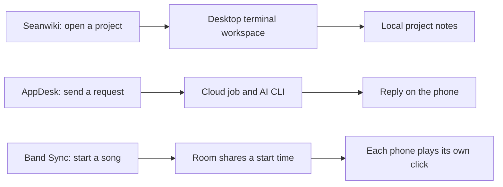

# Apps and architecture

## Architecture at a glance

These projects range from a desktop AI workspace to a metronome that keeps several phones on the same beat. Pick an app below to see what happens after a person taps a button, where the work runs and what gets saved.

Three examples show how different those choices can be:

**Try it locally.** [Market Learning Lab](apps/market-lab#run-the-public-edition) lets you add an item and inspect its HTTP response. [Ausmetic](apps/ausmetic#run-the-pricing-example) compares two fictional offers including delivery. Both examples run without an account.

## AI and development tools

| Project | What it does |
| --- | --- |
| [Seanwiki](apps/seanwiki/README.md) | A Mac workspace for people who use more than one AI coding tool on the same project. |
| [AppDesk](apps/appdesk/README.md) | An iPhone client under development for sending requests about individual apps to a subscription-backed AI assistant. |
| [CodeLens](apps/codelens/README.md) | A browser-based learning tool for exploring how a codebase fits together. |
| [Market Learning Lab](apps/market-lab/README.md) | A runnable local application for following a browser request all the way to a database row. |

## Everyday mobile apps

| Project | What it does |
| --- | --- |
| [Torrens Market](apps/torrens-market/README.md) | A three-language iPhone marketplace for buying and selling secondhand goods. |
| [Chagok](apps/chagok/README.md) | An iPhone planner that keeps calendars, routines, expenses and assistant suggestions together. |
| [Band Sync Metronome](apps/band-sync/README.md) | A shared metronome for musicians who want a common beat on several phones. |
| [WRU Radio](apps/wru-radio/README.md) | An iPhone app for private radio-style communication and voluntary location sharing. |
| [Voice Life OS](apps/voice-life/README.md) | An earlier iPhone prototype for turning spoken daily entries into planning and language-practice material. |
| [Adelaide to Go](apps/adelaide-to-go/README.md) | A mobile prototype for finding local places that suit the time of a visit. |

## Research and work

| Project | What it does |
| --- | --- |
| [Ausmetic](apps/ausmetic/README.md) | A price comparison app for shoppers comparing the delivered cost of the same beauty product. |
| [Job Hunter](apps/job-hunter/README.md) | A local dashboard for keeping a job posting, company research, documents and application status together. |
| [Future Growth Stock Analyzer](apps/stock-analyzer/README.md) | A research dashboard that brings market observations and AI-assisted checklists together. |
| [Kimchi Kangaroo Studio](apps/kimchi-studio/README.md) | A local video-editing workspace for turning footage and transcripts into long videos and short clips. |

## Learning and collaboration

| Project | What it does |
| --- | --- |
| [PTE Study Dashboard](apps/pte-study/README.md) | A local dashboard for studying English from an existing collection of Markdown notes. |
| [Flinders Collab](apps/flinders-collab/README.md) | A student collaboration app for organising group assignments around shared rooms. |
| [Team Collaboration App](apps/team-rooms/README.md) | A mobile project for small teams to coordinate events and room conversations. |
| [Portfolio Website](apps/portfolio-site/README.md) | A project browser built to give each app a short description and a visual walkthrough. |
