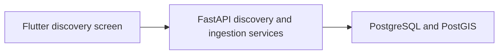

# Adelaide to Go

## Architecture

A mobile prototype for finding local places that suit the time of a visit.

### Follow one interaction

A person explores possible places in the mobile app. The backend queries stored place records alongside geographic information and returns results to the phone.

## APIs and interfaces

| Connection | What crosses it |
| --- | --- |
| Flutter → FastAPI | The mobile client requests place discovery results from the Python backend. |
| Discovery → spatial data | PostGIS extends PostgreSQL with geographic queries. Separate ingestion services prepare the place data that these queries use. |

### Why it works this way

The ingestion work runs separately from a user request. This allows place records to be prepared in the background before a person opens the discovery screen.

[Back to the project index](../../README.md)
