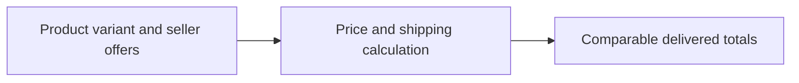

# Ausmetic

## Architecture

A price comparison app for shoppers comparing the delivered cost of the same beauty product.



### Follow one interaction

Select the same product variant and delivery region. The comparison engine checks stock, offer dates and shipping terms, calculates each eligible total, and orders comparable offers by cost.

## APIs and interfaces

| Connection | What crosses it |
| --- | --- |
| Browser Fetch API | The frontend reads a reviewed JSON price snapshot. An offer records its variant, currency and observation period. |
| Pricing engine | The comparison itself is a local JavaScript call. The public example uses fictional seller data so anyone can inspect the calculation offline. |

### Why it works this way

A missing delivery fee can reverse the ranking. The engine represents an unknown cost explicitly and calculates money in integer cents so the displayed comparison is reproducible.

## Run the pricing example

With Node.js 22 or newer, run these commands from the repository root. The engine and its test cases come from the app. The example uses fictional offers and makes no network requests.

```sh
node apps/ausmetic/compare.mjs
node --test apps/ausmetic/pricing.test.mjs
```

Look at [the calculation](pricing.mjs) to follow an offer from its shelf price to its delivered total.

[Back to the project index](../../README.md)
