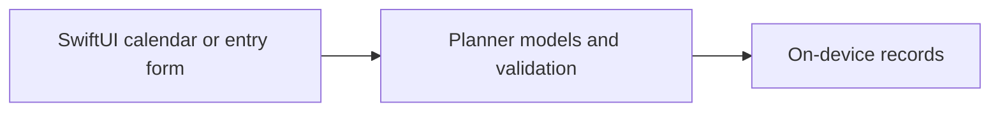

# Chagok

## Architecture

An iPhone planner that keeps calendars, routines, expenses and assistant suggestions together.

### Follow one interaction

Choose a calendar and add an entry. The app translates the input into a record used by the planner views. A proposed assistant change goes through a review step before becoming a saved change.

## APIs and interfaces

| Connection | What crosses it |
| --- | --- |
| SwiftUI → local storage | Planner models are encoded and saved on the device. Opening the calendar reads those records. |
| Assistant connection | Suggestions travel through the configured assistant relay. The planner validates a proposed change before applying it locally. |

### Why it works this way

The planner holds sensitive daily records. Local storage keeps ordinary planning independent of the relay, and the assistant can suggest a change without silently replacing an existing record.

## Read the implementation

See [MoneyToken.swift](MoneyToken.swift) for how a line of text is separated into currency amounts and roles. This source module is an excerpt from the application.

[Back to the project index](../../README.md)
