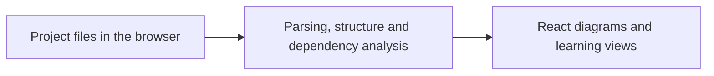

# CodeLens

## Architecture

A browser-based learning tool for exploring how a codebase fits together.



### Follow one interaction

Load a project to build a file tree, then inspect dependencies, routes and functions. The interface presents the analysis as both diagrams and guided explanations.

## APIs and interfaces

| Connection | What crosses it |
| --- | --- |
| Browser → repository archive | The full app can load a public repository through the GitHub archive API or accept project files. The archive is parsed into an in-memory file map. |
| File map → analyser | JavaScript functions inspect source text to find structures such as functions and imports. The public example exercises the function analyser on synthetic code. |

### Why it works this way

The views share analysis results, so a learner can inspect the same project from different angles. Static analysis describes relationships visible in the files; it cannot observe every runtime path.

## Run the function explorer example

From the repository root, use Node.js 22 or newer:

```sh
node apps/codelens/example.mjs
```

This excerpt runs the original function analyser on two synthetic files. Read [the analyser](functionAnalyzer.mjs) to see how it classifies declarations without running the input code.

[Back to the project index](../../README.md)
