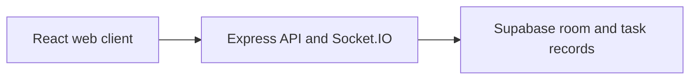

# Flinders Collab

## Architecture

A student collaboration app for organising group assignments around shared rooms.

### Follow one interaction

A student opens a room, adds a task and discusses it with the group. The API handles saved records and the socket connection delivers live updates to connected participants.

## APIs and interfaces

| Connection | What crosses it |
| --- | --- |
| React → Express | HTTP routes handle room records, tasks and files. The server works with Supabase for persistence. |
| Client → Socket.IO | A connected room receives live messages. Reopening the room reads saved data independently of the previous socket connection. |

### Why it works this way

A chat update needs to arrive immediately, while a task must still be there when the room is reopened. The live connection and persistent data store serve those different needs.

[Back to the project index](../../README.md)
