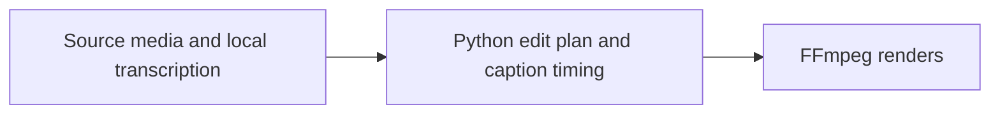

# Kimchi Kangaroo Studio

## Architecture

A local video-editing workspace for turning footage and transcripts into long videos and short clips.

### Follow one interaction

Review the transcript against the footage, choose the passages to keep and adjust caption timing. The render step applies that plan to produce the video output.

## APIs and interfaces

| Connection | What crosses it |
| --- | --- |
| Transcription → edit planner | A local speech-recognition backend, including Whisper, produces a transcript for review. Timing information connects the text to source footage. |
| Python → FFmpeg | The edit plan becomes FFmpeg command-line operations for video, audio and captions. Rendering takes local files as its inputs. |

### Why it works this way

An edit plan is separable from the original footage. A caption correction or a different cut can be reviewed before rendering again. The studio remains in development.

[Back to the project index](../../README.md)
