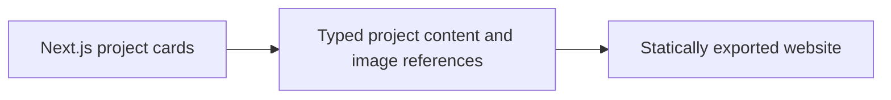

# Portfolio Website

## Architecture

A project browser built to give each app a short description and a visual walkthrough.

### Follow one interaction

Open the Work view and select a card. Its entry supplies the purpose, technical foundation and retained visuals. Adding a project updates the content collection that feeds the build.

## APIs and interfaces

| Connection | What crosses it |
| --- | --- |
| Build → static pages | Next.js reads the typed project catalogue and exports the site as HTML, JavaScript and assets. |
| Browser → project documentation | Each project links directly to its own GitHub guide. Reading the guide needs neither a GitHub API token nor a request through the portfolio server. |

### Why it works this way

A static export can serve the project pages without a live application database. Project descriptions can be updated independently of the apps they describe.

[Back to the project index](../../README.md)
