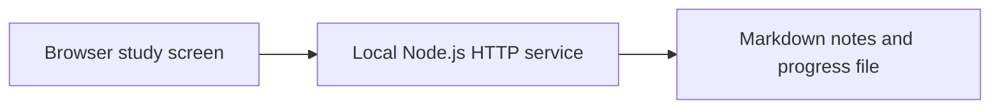

# PTE Study Dashboard

## Architecture

A local dashboard for studying English from an existing collection of Markdown notes.

### Follow one interaction

Choose a study item in the dashboard. The server reads its note, the browser displays it, and a completed session updates the local progress record.

## APIs and interfaces

| Connection | What crosses it |
| --- | --- |
| Browser → local HTTP service | GET /api/list enumerates notes and GET /api/md reads a selected document. The server limits access to the intended note directories. |
| Study progress | The progress endpoint stores study state separately from note content. The note editor uses POST /api/save for an allowed file. |

### Why it works this way

Keeping notes in Markdown lets the learner edit the same material outside the dashboard. The service restricts which paths the browser can read or update.

[Back to the project index](../../README.md)
