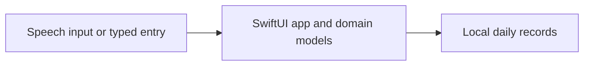

# Voice Life OS

## Architecture

An earlier iPhone prototype for turning spoken daily entries into planning and language-practice material.

### Follow one interaction

Capture an entry by speaking or typing, review the interpreted content and use it in a daily overview. Related planning ideas later carried over into Chagok.

## APIs and interfaces

| Connection | What crosses it |
| --- | --- |
| Microphone → speech recognition | AVAudioEngine supplies audio buffers to Apple’s Speech framework. The resulting text becomes an entry a person can review. |
| Entry → daily view | SwiftUI reads local domain records to construct the overview. The prototype’s personal history is outside the public guide. |

### Why it works this way

Keeping the overview separate from capture lets a person correct an interpretation before relying on it. This page describes the earlier prototype.

[Back to the project index](../../README.md)
